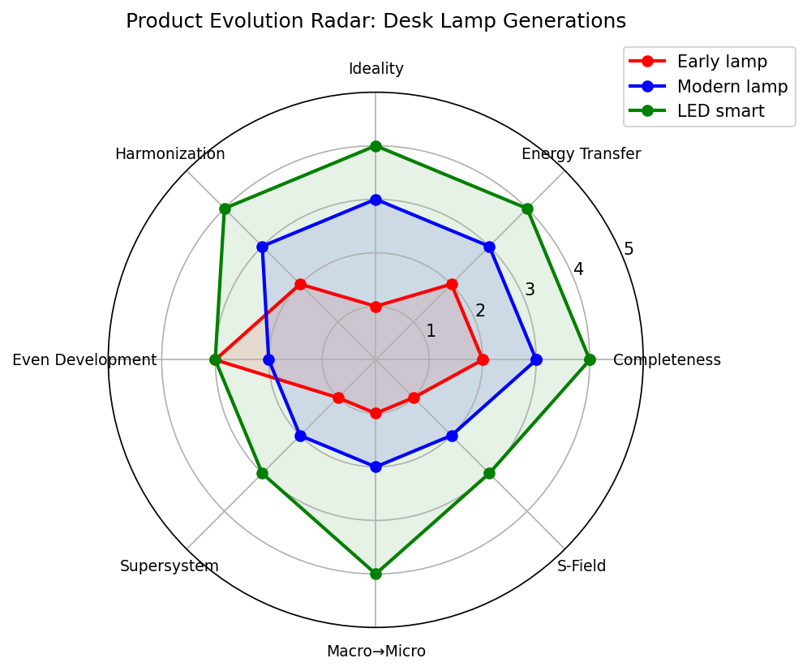

## Introduction

Technical systems do not improve randomly. They follow a small set of recurring directions. The Laws of Evolution turn that observation into a practical forecasting and redesign tool.

We keep the classic eight laws, but we treat them as questions you can ask of any product rather than as theory to memorise.

## The Eight Laws (as Questions)

| Law | Practical Question |
|-----|--------------------|
| Completeness of the system | What part is still missing or only loosely attached? |
| Energy conductivity | How does energy (or information) actually move through the system? Where is it lost? |
| Increasing ideality | Can we get more of the useful function with less system? |
| Harmonization | Are the parts working at compatible rhythms, sizes, or materials? |
| Uneven development | Which part is holding the others back right now? |
| Transition to a supersystem | What larger system could absorb this product so the product itself becomes simpler? |
| Transition from macro to micro | Where is a big mechanical part still doing a job that a field, a surface, or a smaller structure could do? |
| Increasing Su-Field involvement | Are we still relying only on mechanical contact, or have we started using fields? |

## Running Example: Desk Lamp Generations

We score three generations on a simple 0–5 scale for each law.

- Early adjustable desk lamp (incandescent, heavy base, cord)
- Contemporary LED desk lamp (lighter, better light, still mostly mechanical)
- Smart LED lamp (presence sensing, app control, battery or USB-C)

```{r}
#| label: fig-evolution-radar
#| echo: false
#| fig-cap: "Radar chart comparing three generations of desk lamp."
#| out-width: "480px"
#| out-height: "400px"
#| 

# Example R code you can adapt (requires fmsb or ggradar, or base graphics)
# library(fmsb)
# data <- data.frame(
#   row.names = c("Early", "Modern", "Smart"),
#   Completeness = c(2,3,4),
#   Energy = c(2,3,4),
#   Ideality = c(1,3,4),
#   Harmonization = c(2,3,4),
#   EvenDev = c(3,2,3),
#   Supersystem = c(1,2,3),
#   MacroMicro = c(1,2,4),
#   SField = c(1,2,3)
# )
# radarchart(data)



```

The chart immediately above shows:

- Ideality and macro-to-micro have moved the most.
- Uneven development is still visible (the base and cord often lag the light source).
- Transition to super-system is only beginning (integration with room lighting or phone).

## How to Use the Laws for Redesign

1. Score the current product on the eight questions (0–5).
2. Identify the two weakest scores.
3. Ask the corresponding practical question and generate one concrete change.
4. Check that the change does not create a worse contradiction elsewhere.

### Quick Example: Water Bottle

- Completeness: lid and straw are still separate parts → integrate or eliminate.
- Uneven development: insulation has improved, but the drinking mechanism has not → focus there.
- Macro-to-micro: still a bulky rigid container → consider flexible or collapsible structures, or field-based (phase-change) temperature control.

## Classroom Activity

1. Bring (or photograph) an everyday product and one older version of the same product.
2. Score both on the eight laws.
3. Overlay the scores (sketch or simple radar).
4. Propose one redesign move that advances the weakest law.
5. State the new Administrative Contradiction the move might create, and how you would resolve it with an Inventive Principle you already know.

## Obsolete Products Are Useful

An old mechanical kitchen timer, a corded telephone, or a film camera often shows several laws that have not yet been followed. Peasants should (usually) find these easier to analyse than the latest high-tech version. ( Provided that they can tell what the product is in the first place. Bah.)

## References

1. Project TETRIS, Chapter 2: Laws of System Evolution
2. Genrich Altshuller’s original formulations (summarised in most TRIZ primers)

## Conclusions

The laws are forecasting tools, not rigid sequences. A product can jump ahead on one axis while lagging on others; the value is in seeing the lag.
