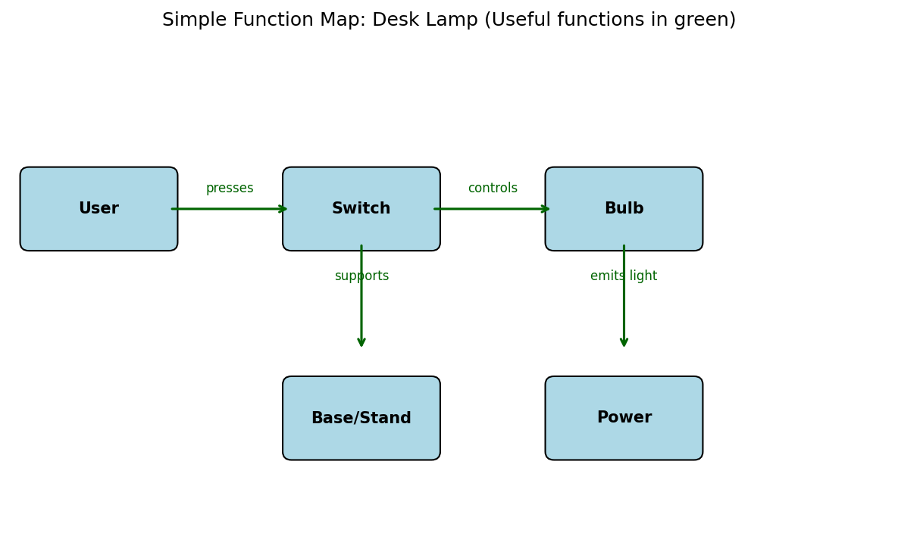

## Introduction

Function Analysis answers a simple question: **what is this system actually doing, to what, and how well?**

It is the bridge between the Administrative Contradiction you already know how to state and the Ideal Final Result. Before you invent, map the useful, harmful, and insufficient actions that create the contradiction.

We stay with the lightest version that is still useful. No multi-level Su-Field models, no standards tables. Just components, actions, and a clear view of what is helping and what is hurting.

## The Process in Four Steps

1. **List the components** that participate in the main job (usually 4–8 is enough).
2. **Name every action** in the form “X acts on Y”.
3. **Classify each action** as Useful, Harmful, or Insufficient.
4. **Ask the trimming question**: which component could disappear if its useful action were performed by something already present?

## Worked Example: Desk Lamp

Components: User, Switch, Bulb, Base/Stand, Power source.

| Action | Type | Notes |
|--------|------|-------|
| User presses Switch | Useful | Starts the process |
| Switch controls Bulb | Useful | |
| Bulb emits light toward surface | Useful | Main function |
| Base supports Bulb | Useful | |
| Bulb heats Base | Harmful | Waste heat |
| Cord tangles / limits placement | Harmful | |
| Light is uneven or too dim in corners | Insufficient | |

```{r}
#| label: fig-lamp-function-map
#| echo: FALSE
#| fig-cap: "Simple function map of a desk lamp. Green arrows = useful actions."
#| out-height: "360px"
#| out-width: "480px"
#| 

# Placeholder – replace with your preferred diagram tool
# or use the pre-generated image below


```


### Trimming Prompt

Which component can we remove?

- The external power cord disappears if the base stores energy (battery) or if the lamp is redesigned to use ambient light.
- The mechanical switch disappears if the bulb itself senses presence or ambient light level.

Both moves increase ideality: the same useful function with fewer components and fewer harmful side-effects.

## Second Example: Bicycle Lock

- Chain acts on wheel (Useful – prevents rotation)
- Lock body acts on chain (Useful)
- Key acts on lock (Useful)
- Chain scratches frame (Harmful)
- Lock is heavy / bulky in pocket (Harmful)
- Chain can be cut (Insufficient)

Trimming direction: move the locking function into the frame or wheel itself (frame-integrated lock, or electronic lock that needs no separate chain).

## Classroom Activity (15–20 minutes)

1. Choose a cheap, familiar object (stapler, water bottle, phone charger, door latch).
2. In pairs, list components and actions on paper.
3. Mark Useful / Harmful / Insufficient with three different colours.
4. Propose one trim: which component can go away, and what already present will take over its useful action?
5. Share the most surprising harmful or insufficient function you found.

## Link to Other Modules

- The harmful and insufficient functions are exactly the contradictions you stated earlier.
- Successful trims move you toward the Ideal Final Result (function delivered, system disappears).
- Available Resources often supply the replacement for the component you trim.

## Further Reading

- Stan Kaplan, *An Introduction to TRIZ* (the short function-analysis section)
- Project TETRIS materials on function analysis (linked in the course references)

